# Authentication & Authorization in Genesis

How Genesis decides **who you are**, **what you may do**, and how **other apps can trust that answer**.
Everything here describes the code on this branch; file references are at the end.

---

## TL;DR

- **Authentication** ends in two signed JWTs: a 30‑minute **access token** and a 30‑day **refresh token**, both tied to a row in the `sessions` table.
- **Genesis itself** trusts a token only if the signature is valid, the user still exists and is active, **and** the session row is still active. Revoking a session takes effect immediately.
- **Other apps (relying parties)** usually verify the signature offline with the public keys at `/.well-known/jwks.json`. A revoked session stays valid for them until the token expires (up to 30 minutes).
- **Authorization** inside Genesis is based on **role** (`user`, `admin`, `root`), read fresh from the database on every request, plus a **policy** that says which accounts an actor may manage. Scopes do **not** restrict Genesis's own API.
- **`aud`** says which API a token is for. Genesis only accepts tokens whose `aud` contains `genesis-api`. **`scope`** says what an OAuth client asked for. Genesis only uses it for `/oauth/userinfo` claims and to decide whether to issue a refresh token.

---

## 1. Mental model

Think of Genesis as a **passport office**.

| Real world | Genesis | Where it lives |
|---|---|---|
| Proving who you are at the counter | Password, Google/GitHub/Facebook sign‑in, or an OAuth client secret | `/token`, `/admin/login`, `/auth/sso/*`, `/oauth/token` |
| The office's record of your visit | A **session** row: who, which device, which refresh token is current, active or revoked | `sessions` table |
| A short‑lived boarding pass | **Access token** (JWT, 30 min). Shown on every API call | `Authorization: Bearer …` |
| A voucher for a new boarding pass | **Refresh token** (JWT, 30 days). Can be exchanged **once**. Reusing an old voucher cancels the session | `/refresh_token`, `/oauth/token` |
| The office's wax seal | The RSA **private key** that signs every token | PEM file at `OAUTH_PRIVATE_KEY_PATH` |
| A public picture of the seal | The **JWKS**: anyone can check a pass without calling the office | `/.well-known/jwks.json` |
| Your clearance level | **Role** in the `users` table. Genesis reads the record. Other apps read the copy printed on the pass (`role` claim) | `users.role` |
| "This pass is valid at gate X" | **Audience** (`aud`) | JWT claim |
| "The holder agreed to share A and B with this app" | **Scope** (`scope`) | JWT claim |

Three questions, three mechanisms:

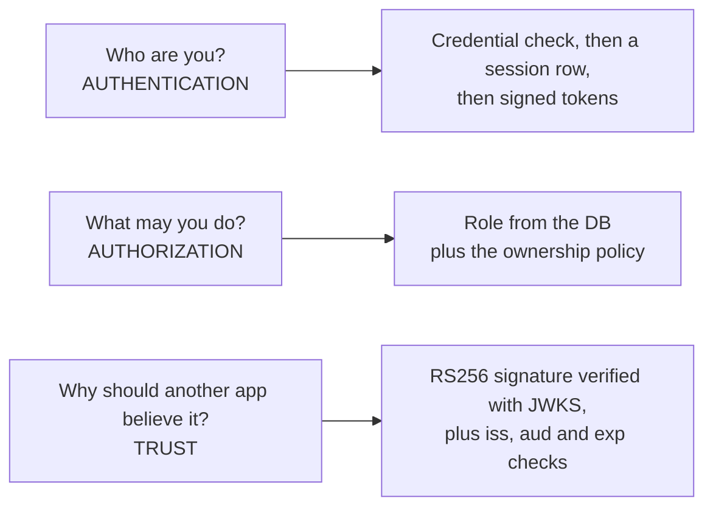

The most important asymmetry to remember:

| Check | Genesis (on its own API) | A relying party verifying offline |
|---|---|---|
| Signature, `iss`, `aud`, `exp`/`nbf`/`iat` | ✅ | ✅ (if implemented correctly) |
| User still exists, not disabled | ✅ every request | ❌ |
| Session not revoked (logout, password change, role change) | ✅ every request | ❌ until the token expires, unless it calls `/token/validate` or `/oauth/userinfo` |
| Current role | ✅ read from the DB | ⚠️ the `role` claim can be up to 30 min stale |

---

## 2. Components and data stores

| ID | Component | What it does |
|---|---|---|
| P1 | **Edge guard** (`SecurityMiddleware`, `TrustedHostMiddleware`, CORS) | Per‑IP rate limits, body‑size cap, security headers, host and origin allow‑lists. Runs before any route. |
| P2 | **Credential login** (`/token`, `/admin/login`) | Password check (Argon2id), per‑account lockout, optional email‑verified gate. |
| P3 | **SSO broker** (`/auth/sso/*`) | Genesis acts as an OAuth *client* of Google, GitHub or Facebook, then hands tokens to the web app. |
| P4 | **OIDC provider** (`/oauth/*`, discovery) | Genesis acts as an OAuth/OIDC *server* for other apps: authorize, token, userinfo. |
| P5 | **Token service** (`app/auth/auth.py`, `app/auth/keys.py`) | Builds claims, signs and verifies JWTs, publishes the JWKS. |
| P6 | **Session service** | Creates sessions, caps concurrent sessions, rotates refresh tokens, detects replay, revokes. |
| P7 | **Authorization** (`require_role`, `app/auth/policy.py`) | Role gates and "who may manage whom" decisions. |
| P8 | **Resource APIs** (`/users`, `/profile`, `/admin`) | The data the tokens protect. |

| ID | Store | Holds |
|---|---|---|
| D1 | `users` | Identity, password hash, `role`, `disabled`/`is_active`, `email_verified` |
| D2 | `sessions` | One row per sign‑in: `refresh_token_jti`, device, `expires_at`, `is_active`, revoke reason |
| D3 | `oauth_clients` | Registered apps: secret hash (`sha256$…`), redirect URIs, allowed scopes, audiences and grants, first‑party flag |
| D4 | `authorization_codes` | One‑time OIDC codes (10 min) with the PKCE challenge, nonce and scope |
| D5 | `oauth_accounts`, `profiles` | Linked SSO identities and profile data (claims for userinfo and ID tokens) |
| D6 | Signing key files | RSA private and public PEM (`OAUTH_PRIVATE_KEY_PATH`, `OAUTH_PUBLIC_KEY_PATH`), kid = `OAUTH_JWT_KID` |
| D7 | In‑memory security store | Rate counters, lockouts, SSO `state` (with PKCE verifier and nonce), SSO hand‑off codes. **Per process**, see §7. |

---

## 3. Data flow diagrams

### 3.1 Context (level 0)

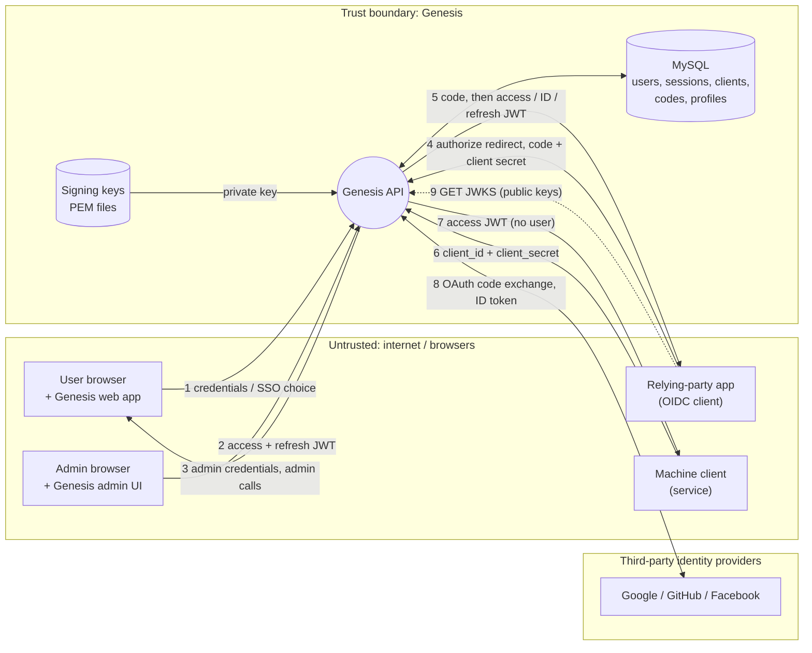

### 3.2 Signing in (level 1)

Every way of signing in follows the same pipeline: check the credential, create a session, sign tokens.

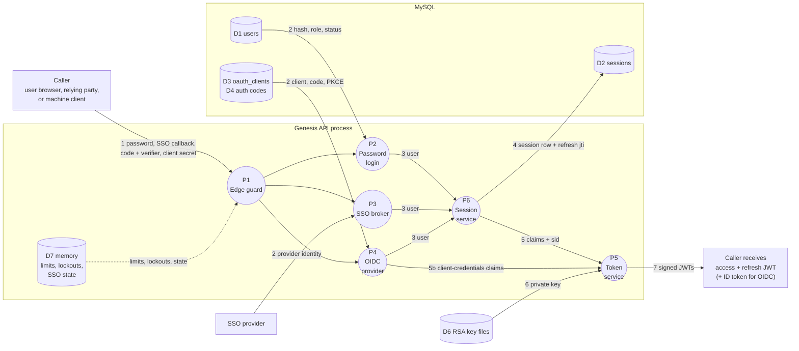

1. The request passes the edge guard (rate limits, body cap). Lockout counters and SSO `state` live in D7.
2. The credential is checked against its source: a password hash in `users`, the provider's identity for SSO, or the client, one‑time code and PKCE challenge for OIDC.
3. → 4. A **session row is written first**, holding the id (`jti`) of the refresh token about to be issued.
5. → 7. Claims plus `sid` are signed with the private key. Client‑credentials tokens skip the session (5b): there's no user to sign out.

### 3.3 Calling a protected Genesis endpoint (level 1)

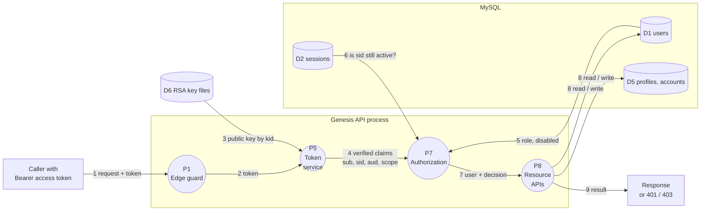

Steps 5 and 6 are what make Genesis's own checks **stateful**: the role is read fresh, and a revoked session is rejected even though the JWT is still cryptographically valid.

### 3.4 A relying party verifying a Genesis token

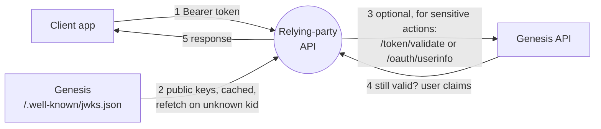

Without step 3, verification is **stateless**: fast and independent of Genesis being up, but blind to logout or revocation until `exp`.

---

## 4. Authentication

### 4.1 Ways in

| Method | Endpoint | Used by | Creates session? | `auth_method` claim | Refresh token? |
|---|---|---|---|---|---|
| Username + password | `POST /token` (form) | Genesis web app, scripts | ✅ | `password` | ✅ |
| Admin username + password | `POST /admin/login` | Admin UI. Rejects `user` role | ✅ | `password` | ✅ |
| Social sign‑in | `GET /auth/sso/{provider}/authorize` … `POST /auth/sso/exchange` | Web app | ✅ | `google` / `github` / `facebook` | ✅ |
| OIDC authorization code (+PKCE) | `GET`/`POST /oauth/authorize`, then `POST /oauth/token` | Other apps (relying parties) | ✅ | `oidc` | Only with `offline_access` scope **and** the client has the `refresh_token` grant |
| Client credentials | `POST /oauth/token` `grant_type=client_credentials` | Back‑end services | ❌ | `client_credentials` | ❌ |
| Refresh (first‑party) | `POST /refresh_token` (refresh token as Bearer) | Web app | rotates existing | unchanged | new one |
| Refresh (OIDC client) | `POST /oauth/token` `grant_type=refresh_token` + client auth | Relying party | rotates existing | unchanged | new one |

Registration (`POST /users/`) is public and creates a `user`‑role account. It does **not** sign you in.

### 4.2 Password sign‑in and an API call

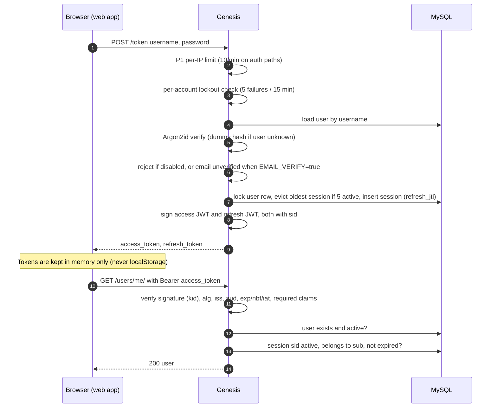

### 4.3 What happens to a Bearer token on every request

`oauth_authenticate_current_user` runs `decode_token` and then `validate_access_session`:

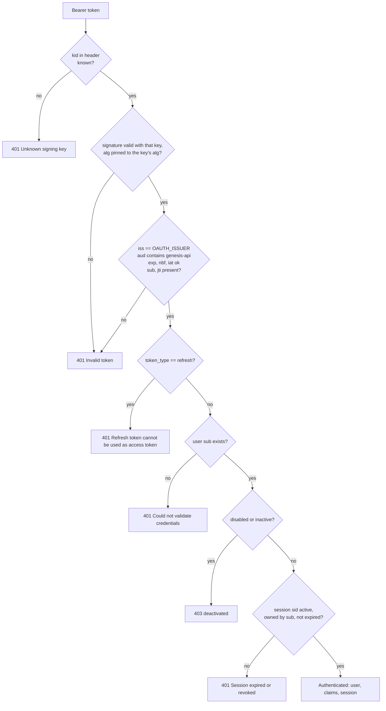

Because of the last check, a token is useless to Genesis the moment its session is revoked, even though it still looks valid cryptographically.

### 4.4 Refresh rotation and replay detection

Each session stores exactly one valid refresh token id (`refresh_token_jti`). Using a refresh token swaps it for a new one with a database compare‑and‑swap.

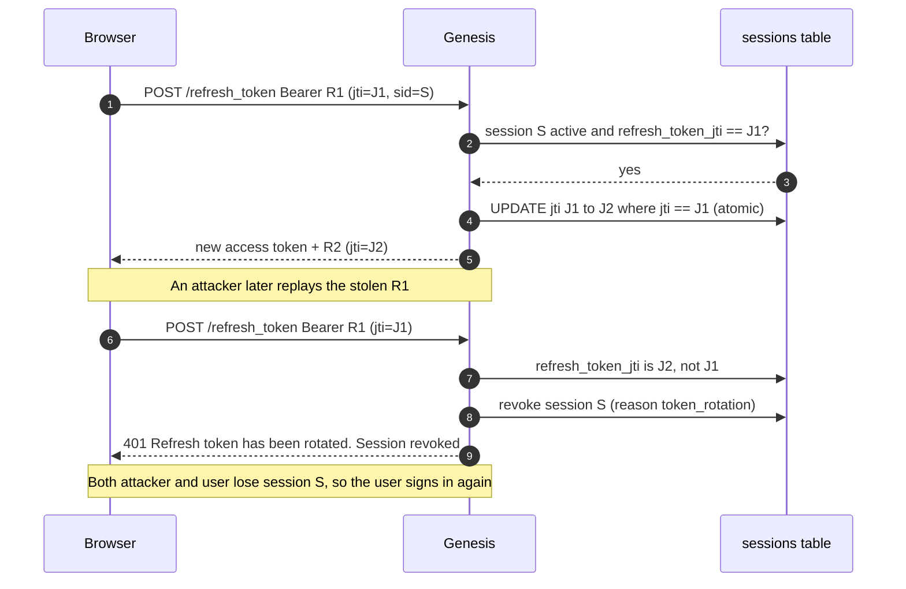

Notes:
- The session's `expires_at` is fixed at sign‑in + `OAUTH_REFRESH_TOKEN_TTL_DAYS`. Refreshing does **not** extend it, so every session has a hard 30‑day cap.
- Refresh tokens issued to an OIDC client carry `client_id` and can only be redeemed at `/oauth/token` by **that** client (with its secret if confidential). First‑party refresh tokens are rejected there, and client‑bound ones are rejected at `/refresh_token`.
- New tokens after a refresh get the **current** `role`, `email` and `username` from the database.

### 4.5 Social sign‑in (Google / GitHub / Facebook)

Genesis is the OAuth **client** here. The provider redirects to the **API**, and the API hands the result to the **web app** without putting tokens in a URL.

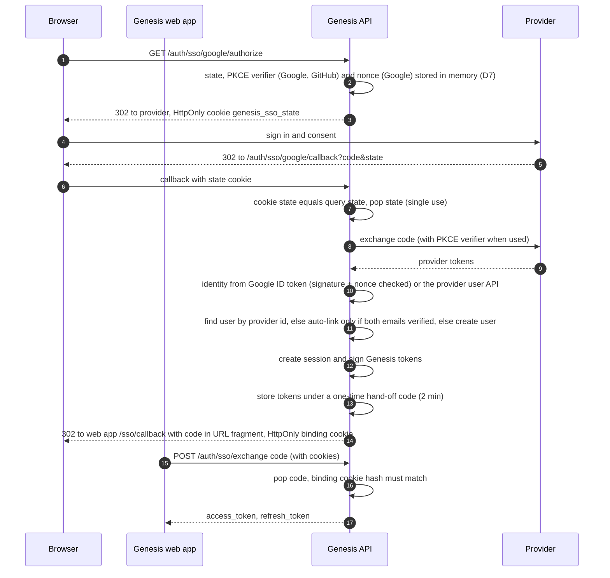

Why it's built this way:
- **State cookie + server‑side state:** a callback that didn't start in this browser is rejected (CSRF).
- **Fragment + binding cookie:** the URL fragment is never sent to servers or logged, and a code planted in someone else's browser can't sign them in (login CSRF).
- **Auto‑link only when both sides verified the email:** otherwise someone could pre‑register a victim's email with a password and inherit the victim's later Google sign‑in.

Linking a provider to an existing account starts with an **authenticated** `POST /auth/sso/{provider}/link`. Its state carries the user id.

### 4.6 OIDC: Genesis as identity provider for other apps

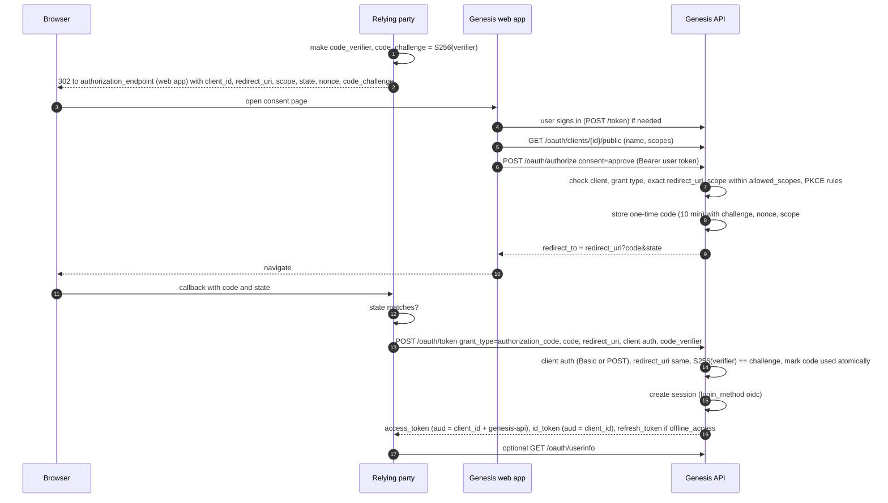

Rules enforced:
- `response_type=code` only. `redirect_uri` must match a registered URI exactly.
- **PKCE** supports `S256` only. **Public** (non‑confidential) clients **must** use it.
- **First‑party** clients (`is_first_party=true`) may use `GET /oauth/authorize` with a Bearer token and skip consent. Every other client gets `403 consent_required` there and must go through the consent screen (`POST /oauth/authorize`).
- Codes are single‑use, last 10 minutes, and are bound to client, redirect URI and PKCE challenge.

### 4.7 Client credentials (machine to machine)

`POST /oauth/token grant_type=client_credentials` with a **confidential** client's id and secret returns an access token where `sub = client_id`, `auth_method = client_credentials`, and `aud = client's allowed_audiences + genesis-api`. There is no session, no refresh token and no `role`.
Requested scopes must be within the client's `allowed_scopes`.
These tokens pass `POST /token/validate`, but they can't call user endpoints: there is no user whose id equals the client id.

### 4.8 Sessions and revocation

| Event | Effect |
|---|---|
| Sign‑in when 5 sessions are already active (`MAX_CONCURRENT_SESSIONS`) | Oldest session revoked (`session_limit`) |
| `DELETE /auth/sessions/{id}` | That session revoked (your own only) |
| `DELETE /auth/sessions` | All your **other** sessions revoked |
| Refresh token replay | Session revoked (`token_rotation`) |
| Password change (`POST /users/me/password`) | Other sessions revoked |
| Admin password reset | All of the target's sessions revoked |
| Role change | All of the target's sessions revoked (tokens carry `role`) |
| Account disabled | All of the target's sessions revoked, and every request returns 403 even before that |

Revocation is instant for Genesis. Relying parties that only verify offline keep accepting the access token until `exp` (≤ 30 min).

### 4.9 Brute‑force and abuse controls

| Control | Default | Scope |
|---|---|---|
| Global rate limit | 30 req/s | per client IP (transport peer, never `X-Forwarded-For`) |
| Auth rate limit | 10 req/min | per IP: `/token`, `/admin/login`, registration, `/oauth/token`, password change, email verify/resend, SSO authorize/callback/link/exchange |
| Refresh rate limit | 60 req/min | per IP on `/refresh_token` |
| Account lockout | 5 failures in 15 min, then locked up to 15 min | per **submitted username** (unknown names lock the same way, so lockouts don't reveal accounts). The same mechanism applies to client secrets, per client |
| Timing equalisation | dummy Argon2id verify | when the username doesn't exist |
| Password hashing | Argon2id (19 MiB, t=2, p=1) | legacy bcrypt hashes are upgraded on the next successful login |
| Client secrets | stored as `sha256$…` (high‑entropy random secrets) | legacy bcrypt hashes are upgraded on first use |
| Email verification | off by default (`EMAIL_VERIFY`) | when on, password sign‑in requires a verified email |

---

## 5. Authorization

### 5.1 The layers a request passes through

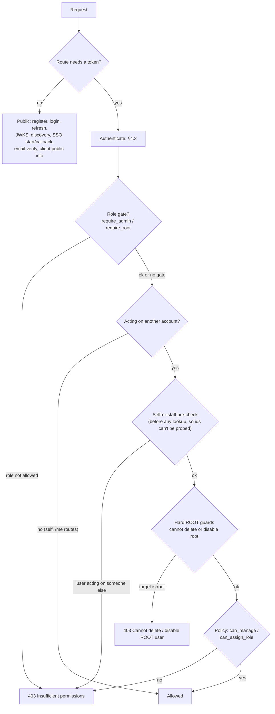

Role‑gate, self‑or‑staff and policy denials are written to the audit log as `authz_denied`.

### 5.2 Roles

| Role | How you get it | Meaning |
|---|---|---|
| `user` | Registration, SSO sign‑up | Manages only their own account |
| `admin` | Promoted by root | Staff: manages regular users, OAuth clients and analytics |
| `root` | Seeded on first start (`adam`), or promoted by another root | Superuser, but can't manage *other* roots and can't change its own role |

The root account is created by `app/database/seed.py` when no root exists. Its password comes from `BOOTSTRAP_ROOT_PASSWORD`, or is random and printed once in the logs (production requires `BOOTSTRAP_ROOT_PASSWORD`).

### 5.3 Who may manage whom (`can_manage`)

"Manage" covers updating, deleting, disabling and admin password resets.

| Actor ↓ / Target → | self | `user` | `admin` | other `root` |
|---|---|---|---|---|
| `user` | ✅ | ❌ | ❌ | ❌ |
| `admin` | ✅ | ✅ | ❌ | ❌ |
| `root` | ✅ | ✅ | ✅ | ❌ |

On top of the table: **nobody** can delete or disable a root account, and admins reset their own password through `/users/me/password`, not the admin reset endpoint.

### 5.4 Who may change roles (`can_assign_role`, `POST /admin/users/{id}/role`)

| Actor | Allowed |
|---|---|
| anyone, on **themselves** | ❌ never (blocks self‑promotion, and stops a root from demoting itself out of existence) |
| `root` on a `user` or `admin` | ✅ any of `user`, `admin`, `root` |
| `root` on another `root` | ❌ |
| `admin` | only `user` → `user` (a no‑op). Can't promote, can't demote admins or root |
| `user` | ❌ (blocked by `require_admin`) |

A successful role change revokes all of the target's sessions, so their next tokens show the new role.

### 5.5 Endpoint map

| Area | Endpoints | Rule |
|---|---|---|
| Public | `POST /users/`, `POST /token`, `POST /admin/login`, `POST /refresh_token`, `/.well-known/*`, `/auth/sso/providers`, SSO authorize/callback/exchange, `/auth/email/*`, `/auth/config`, `GET /oauth/clients/{id}/public`, `POST /oauth/token` (client auth inside) | none, or credentials in the body |
| Self | `/users/me/`, `POST /users/me/password`, `/profile/me/*`, `/auth/sessions*`, SSO link/unlink/linked, `/oauth/authorize`, `/oauth/userinfo` | any valid user token, acts on the caller only |
| Self or staff | `GET/PUT/DELETE /users/{id}` | self, or `admin`/`root`. PUT and DELETE also need `can_manage`. DELETE never on root |
| Staff | `GET /users/`, `POST /users/search`, `/admin/analytics`, `/admin/users*`, `/admin/clients*` | `require_admin`. User mutations also go through §5.3 and §5.4 |
| Services | `POST /token/validate` | any valid token. Client‑credentials tokens skip the session check |

---

## 6. JWT in Genesis

### 6.1 Anatomy

A JWT is three base64url parts joined by dots: `header.payload.signature`. The signature covers the first two parts, so changing any claim invalidates it. The payload is **readable by anyone** (it's not encrypted), so it must never contain secrets.

A real access token from `POST /token` (dev settings), decoded:

```jsonc
// header
{ "alg": "RS256", "typ": "JWT", "kid": "genesis-dev-1" }

// payload
{
  "iss": "http://localhost:8001",          // who issued it (OAUTH_ISSUER)
  "aud": ["genesis-api"],                  // who it is for (OAUTH_DEFAULT_AUDIENCE)
  "iat": 1760860800,                       // issued at
  "nbf": 1760860800,                       // not valid before
  "exp": 1760862600,                       // expires: iat + 30 min
  "jti": "7d2c…",                          // unique token id
  "sub": "3f1a…",                          // user id
  "username": "alice",
  "email": "alice@example.com",
  "email_verified": true,
  "auth_method": "password",               // password | google | github | facebook | oidc | client_credentials
  "scope": "openid profile email",
  "sid": "9b77…",                          // session row id
  "role": "user"                           // user | admin | root (snapshot at issue time)
}
```

### 6.2 Claims by token type

| Claim | Access (first‑party) | Access (OIDC client) | Refresh | Access (client credentials) | ID token |
|---|---|---|---|---|---|
| `iss` | issuer | issuer | issuer | issuer | issuer |
| `aud` | `["genesis-api"]` | `[client_id, "genesis-api"]` | same as its access token | client's `allowed_audiences` + `genesis-api` | `client_id` (string) |
| `exp` | +30 min | +30 min | +30 days | +30 min | +30 min |
| `iat`, `nbf` | ✅ | ✅ | ✅ | ✅ | `iat` only |
| `jti` | random | random | **= `sessions.refresh_token_jti`** | random | – |
| `sub` | user id | user id | user id | **client id** | user id |
| `sid` | ✅ | ✅ | ✅ | – | – |
| `token_type` | – (means access) | – | `"refresh"` | – | – |
| `scope` | `openid profile email` | as consented | as its access token | as requested | – |
| `role`, `username` | ✅ | ✅ | ✅ | – | – |
| `email`, `email_verified` | ✅ | ✅ | ✅ | – | ✅ |
| `client_id` | – | ✅ | OIDC only | ✅ | – |
| `nonce`, `at_hash`, `auth_time`, name claims | – | – | – | – | ✅ |

### 6.3 `iss`: issuer

Set from `OAUTH_ISSUER` and checked exactly on decode. It must be the public URL of Genesis (production requires `https://`). Relying parties must configure the **same string**, and the discovery document advertises it.

### 6.4 `aud`: audience ("who is this token for?")

- **Genesis only accepts tokens whose `aud` contains `OAUTH_DEFAULT_AUDIENCE`** (`genesis-api`). That's why OIDC and client‑credentials tokens always add `genesis-api` next to their own audience.
- A relying party should require **its own** audience: its `client_id` for OIDC tokens, or the audience it was registered with (`allowed_audiences`) for client credentials. That stops a token minted for app A from being replayed against app B.
- First‑party tokens (web app sign‑in) carry only `genesis-api`. An app that accepts them is effectively saying "any Genesis session is good here".
- A token with several audiences is valid at **all** of them (see §7, sharp edge 1).
- The **ID token** has `aud = client_id` only. It proves the sign‑in to the client and is **not** an access token: Genesis rejects it because `genesis-api` isn't in its audience and it has no `jti`/`sid`.

### 6.5 `scope`: what the client was granted

- **Supported scopes** (discovery): `openid`, `profile`, `email`, `offline_access`. A client may also be registered with other scope strings, which are validated against `allowed_scopes` and passed through untouched for relying parties to enforce.
- **Where scope comes from:** first‑party sign‑ins always get `openid profile email`. OIDC tokens get what the user consented to (must be ⊆ the client's `allowed_scopes`). Client credentials get what was requested (also ⊆ `allowed_scopes`).
- **Where Genesis enforces it:**
  - `/oauth/userinfo` requires `openid`. `email` adds `email` and `email_verified`. `profile` adds name, nickname, picture and similar claims.
  - `offline_access` (plus the client's `refresh_token` grant) is required to get an OIDC refresh token.
  - The authorize step rejects any scope the client isn't registered for.
- **Where Genesis does *not* enforce it:** its own `/users`, `/profile`, `/auth/sessions` and `/admin` endpoints. Those use **role + policy** only.

### 6.6 `sub`, `sid`, `jti`, `token_type`, `role`

- **`sub`** is the user's UUID (or the client id for client credentials). It's the stable identifier relying parties should key on. Don't key on username or email, which can change.
- **`sid`** binds an access token to a session row. Genesis rejects the token once that row is revoked or expired.
- **`jti`** makes each token unique. For refresh tokens it's the value stored in `sessions.refresh_token_jti`, which is how rotation and replay detection work.
- **`token_type: "refresh"`** marks refresh tokens. Genesis refuses them as access tokens, and refuses access tokens at the refresh endpoints.
- **`role`** is a snapshot for relying parties that authorize offline. Genesis itself ignores it and reads `users.role`.

### 6.7 Lifetimes

| Thing | Default | Setting |
|---|---|---|
| Access token, ID token | 30 min | `OAUTH_ACCESS_TOKEN_EXPIRE_MINUTES` |
| Refresh token | 30 days | `OAUTH_REFRESH_TOKEN_TTL_DAYS` |
| Session (hard cap, not extended by refresh) | 30 days from sign‑in | `OAUTH_REFRESH_TOKEN_TTL_DAYS` |
| OIDC authorization code | 10 min, single use | fixed |
| SSO hand‑off code | 2 min, single use | fixed |
| JWKS in‑process cache | 5 min | `JWKS_CACHE_TTL_SECONDS` |

### 6.8 Signing keys, `kid` and JWKS

- **RS256** (RSA‑SHA256): the private key signs and the public key verifies. Only Genesis can mint tokens, and anyone can check them.
- Keys are loaded from `OAUTH_PRIVATE_KEY_PATH` and `OAUTH_PUBLIC_KEY_PATH`. They must be a matching RSA pair of at least 2048 bits, or startup fails. The `kid` header is `OAUTH_JWT_KID`. `entrypoint.sh` generates a pair into `./secrets` if the private key file is missing.
- `/.well-known/jwks.json` publishes the public key as a JWK (`kty`, `n`, `e`, `kid`, `alg`, `use: sig`).
- On decode, Genesis looks up the key **by `kid`** and pins `algorithms=[that key's alg]`. That blocks `alg: none` and RS256→HS256 confusion attacks.
- **HS256 development fallback:** when no key paths are configured and `ENVIRONMENT != production`, Genesis signs with `OAUTH_SECRET_KEY` (at least 32 characters, and never the formerly committed default). Production refuses to start without RSA keys and an `https` issuer.

### 6.9 How a relying party should verify a Genesis token

```python
import jwt  # PyJWT

ISSUER = "https://auth.example.com"          # exactly Genesis's OAUTH_ISSUER
AUDIENCE = "<your client_id or API audience>"
jwks = jwt.PyJWKClient(f"{ISSUER}/.well-known/jwks.json")  # caches keys

def verify(token: str) -> dict:
    key = jwks.get_signing_key_from_jwt(token).key           # chosen by kid
    claims = jwt.decode(
        token, key,
        algorithms=["RS256"],                                # never trust the header's alg
        audience=AUDIENCE,
        issuer=ISSUER,
        options={"require": ["exp", "iat", "iss", "aud", "sub"]},
    )
    if claims.get("token_type") == "refresh":
        raise jwt.InvalidTokenError("refresh token used as access token")
    return claims  # authorize on claims["sub"], claims["scope"], claims.get("role")
```

For actions where a revoked session must stop working **immediately** (payments, account changes), also call `POST /token/validate` or `GET /oauth/userinfo`. Both check the session server‑side.

---

## 7. Sharp edges and known limits

1. **An OIDC client's access token is a full user token for Genesis's own API.** OIDC access tokens include `genesis-api` in `aud`, and Genesis doesn't check `scope` or `client_id` on `/users`, `/profile`, `/auth/sessions` or `/admin`. So a third‑party app that the user approved for just `openid` can call those endpoints as the user. For example, it can delete the user's account with `DELETE /users/{self}`. If the user is an `admin`, it can call the admin API too (verified against this branch). Until this changes, only register OIDC clients you trust as much as the web app. A fix would reject tokens carrying `client_id` on Genesis's own resource endpoints (or require a dedicated scope), and/or stop adding `genesis-api` to client tokens.
2. **The `role` claim can be stale for relying parties** for up to one access‑token lifetime after a role change. Genesis revokes the sessions, so the next refresh fails, but offline verifiers don't see that.
3. **One signing key at a time.** Only `OAUTH_JWT_KID` is loaded and published, and the `jwk_keys` table is not used. Replacing the key files invalidates every outstanding access and refresh token, so all users must sign in again. Relying parties should refetch the JWKS when they see an unknown `kid`. Losing the key files has the same effect, so they must persist across restarts (mounted volume or secret, never baked into the image).
4. **Security state is in memory and per process.** Rate limits, lockouts, SSO `state` and hand‑off codes live in D7. Genesis therefore runs `--workers 1` and a single replica. With several replicas, SSO callbacks and hand‑offs fail whenever they reach a different pod, and limits multiply. Scaling out needs a shared store (see `redis-decision.md`) or sticky routing.
5. **Any `admin` can manage OAuth clients**, including creating `is_first_party` clients that skip consent and rotating secrets.
6. **ID token `auth_time`** is the time the token was minted, not the time of the original sign‑in.
7. **Admin and user tokens are the same kind of token.** `/admin/login` only differs in rejecting `user`‑role accounts. Admin power comes from the database role on each request, not from which endpoint issued the token.

---

## 8. Code map

| Concern | File |
|---|---|
| Claims, sign, verify, session binding, role gates, re‑auth | `app/auth/auth.py` |
| Key loading, JWKS, HS256 dev fallback | `app/auth/keys.py` |
| Who may manage whom, role assignment | `app/auth/policy.py` |
| Per‑account lockout | `app/auth/throttle.py` |
| Per‑IP limits, body cap, security headers | `app/middleware/security.py` |
| In‑memory security store | `app/utils/security_store.py` |
| Password and client‑secret hashing | `app/utils/security.py` |
| `/token`, `/refresh_token`, JWKS, sessions API | `app/routes/auth.py`, `app/services/auth_service.py`, `app/services/session_service.py` |
| OIDC provider | `app/routes/oidc.py`, `app/services/oidc_service.py` |
| Social sign‑in | `app/routes/sso.py`, `app/services/sso_service.py`, `app/auth/oauth_providers.py` |
| Admin API | `app/routes/admin.py`, `app/services/admin_service.py` |
| User API | `app/routes/users.py` |
| Root bootstrap | `app/database/seed.py` |
| Settings | `app/config.py` |
| Web app token handling (memory only, single‑flight refresh) | `web/src/store/index.js`, `web/src/utils/jwt.js` |

Related guides: [Native Auth Guide](native-auth-guide.md) · [OIDC Integration](oidc-guide.md) · [SSO Setup](sso/README.md) · [Security hardening](security-hardening.md) · [API Reference](api-reference.md)
