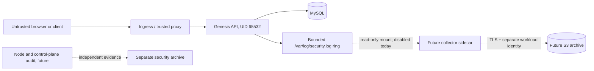

# Security events and container threat model

Status: implemented local logging and container controls; future collection is a **disabled, unverified placeholder**. No cloud resources or credentials were created. Reviewed 2026-10-25.

## Scope and decision

Genesis is an identity service. The protected assets are credentials/signing keys, accounts and privileges, sessions, security evidence, and host availability. Threat actors include anonymous callers, malicious users/clients, compromised administrators, an attacker executing code as the application, and a compromised node/operator account.

Use **50 MiB per API instance**, including the active file: `/var/log/security.log` plus `.1` through `.4`, each at most 10 MiB. `.1` is newest. Choose 100 MiB only after measuring event volume; it retains `.1` through `.9`. This is a byte budget, not a retention period. No cron, shell, logrotate package, or collector is needed for rotation.

At an illustrative 1 KiB/event, 50 MiB holds about 51,200 events: roughly 14 hours at one event/second or 85 minutes at ten/second. Multiple records per request reduce the request history retained. Doubling the budget doubles that window. It does not prevent an attacker from flooding older evidence out of the ring.

The application's ring is mounted on a separate bounded tmpfs: 60 MiB by default (110 MiB for the larger ring). This spends RAM, not persistent disk, and provides headroom beyond the 50 MiB file budget. Kubernetes charges memory-backed emptyDir writes to container memory. Review the existing 384/512 MiB API limits under real traffic before rollout. Each deployment/namespace gets its own budget.

## Trust boundaries



Request data becomes trusted identity only after credential or token/session verification. Source IP comes from the transport peer after Uvicorn's proxy handling; the audit layer never reads forwarding headers itself. **The existing Helm trust setting covers the pod CIDR**: a compromised allowed pod can forge forwarded attribution. Narrow proxy trust/network reachability before relying on IP as strong evidence. IP addresses identify a connection, not a person. Synchronize node clocks and verify real-client attribution through the deployed ingress.

## Event contract

Each line is one JSON object, schema version 1. There is no free-form request dump.

| Attribute | Recorded value and trust rule |
| --- | --- |
| `who` | Verified user/client ID and role when available; otherwise explicitly anonymous. CLI uses numeric OS UID; lifecycle uses service identity. Source IP is recorded separately. |
| `when` | Server UTC timestamp and server-generated request ID, shared across events in one request. Client request IDs are ignored. Each event also has its own UUID. |
| `where` | Service, instance hostname, process ID, HTTP method, and route **template**. Unknown routes use `<unmatched>`; raw URLs never enter the security log. |
| `what` | Stable event name, outcome, severity, bounded allowlisted metadata, affected object ID, and HTTP status where available. An affected `user_id` does not become the actor. |

Example (IDs shortened for illustration):

```json
{"schema_version":1,"event_id":"event-uuid","when":{"timestamp":"2026-10-25T14:00:00.000+00:00","request_id":"request-uuid"},"who":{"type":"user","id":"actor-uuid","role":"admin","source_ip":"192.0.2.10"},"where":{"service":"genesis-iam","instance":"pod-name","pid":1,"method":"POST","route":"/admin/users/{user_id}/password"},"what":{"event":"password_reset_by_admin","outcome":"success","severity":"info","details":{"actor":"actor-uuid","target":"target-uuid"}}}
```

Submitted usernames are hashed for failed-login correlation. These short SHA-256 hashes are pseudonyms, **not anonymization**: common usernames can be guessed offline. Passwords, bearer/refresh/provider tokens, cookies, authorization codes, email addresses, request/response bodies, headers, query strings, raw session IDs, and exception messages are excluded from the security schema. Session references are hashed. Control characters are replaced, fields are length-limited, JSON is encoded, and records are capped at 8 KiB. Oversized metadata is replaced while retaining the event. Unknown extra fields are discarded.

## Threats, evidence, controls and residual risk

| Threat / abuse case | Events or evidence | Controls implemented and remaining limits |
| --- | --- | --- |
| Credential stuffing, guessing, client-secret abuse | `login_failed`, `login_succeeded`, `client_auth_failed`, `client_authenticated`, `account_locked`, `login_throttled`; request result | Existing IP/account limits; failed attempts remain anonymous. A successful credential check can identify a caller even if a later policy denies sign-in. |
| Stolen session or refresh replay | `refresh_replay_detected`, `session_refreshed`, `session_revoked`, `sessions_revoked`; 401 request result | Replay revokes the session; raw session IDs/JTIs are never recorded. Invalid tokens cannot assert an identity. |
| Privilege escalation, IDOR, abusive administration | `authz_denied`, `role_changed`, `user_enabled/disabled/deleted/updated`, `password_reset_by_admin`, `privileged_access` | Existing authorization policy; actor and target separated. Successful admin reads and sensitive writes get request summaries. Logs cannot tell whether valid admin credentials were stolen. |
| Account takeover via recovery, SSO or consent | Password changes/rehashes, email verification, SSO registration/link/unlink, `sso_failed`, consent decisions, code redemption | Authenticated actor context crosses sync dependencies; SSO error redirects explicitly log failure even though HTTP returns 302. No provider error strings or callback query secrets. |
| Malformed input, rate-limit abuse, parser failures | `request_rejected` with status (400/401/403/404/413/422/429 etc.); `request_failed` for 5xx | Auditing wraps host/CORS/security middleware. Validation payloads and unmatched paths are omitted. A validation failure is not proof of an attack. |
| Break-glass or bootstrap misuse | `cli_started/failed`, `password_reset_cli`, `oauth_client_created`, `signing_keys_generated`, `root_bootstrapped` | OS UID identifies a process account, not the human operator. Correlate with future Kubernetes exec/control-plane and host audit records. |
| Log injection or information disclosure | Safe JSON records; permissions failures produce a fixed alarm | Allowlist, encoding, bounds, mode 0640; non-web-accessible mount; security logger does not propagate to stdout. Uvicorn and frontend access logging are disabled to avoid query-string secrets. Review ingress/operational logging separately. |
| Log flooding, disk exhaustion, logger failure | Bounded files; `SECURITY_LOG_WRITE_FAILED` on stderr at most once/minute, local handler failure counter | Rename rotation before append, oldest deletion, separate tmpfs cap. Logging errors do not change authentication decisions or block requests with an exception. CPU/I/O abuse and eviction of old evidence remain possible; ingress limits are still needed. |
| Attacker executes code / obtains a shell equivalent | Application logs become untrustworthy; future independent runtime audit needed | Shell-free API and web images, UID 65532, read-only roots, no added capabilities or privilege escalation, bounded writable mounts. Python can still read secrets, open sockets, modify writable files, or execute code. |
| Container escape / host takeover | Future node/runtime detections: exec/debug access, namespace/mount/capability changes, unexpected processes/egress | Default seccomp, no Docker socket/host PID/network/privileged mode, no automatic service-account token, resource limits. Patch host/kernel/runtime, restrict exec/ephemeral-container RBAC, consider sandboxed runtimes. This change does not prove escape resistance. |
| Tampering/deletion/forged logs after compromise | Local evidence may be deleted, forged, suppressed, or silently altered | No-follow and hard-link checks prevent accidental redirection; cooperating processes serialize rotation. The app owns the log directory and can erase it. A sidecar cannot make that directory immutable. Off-host independent storage and monitoring are still required. |
| Collector compromise or S3 outage (future) | Archive arrival checks, collector errors/backlog, cloud audit | Read-only source mount, separate bounded spool, identity only mounted in collector, digest requirement. Outage longer than local retention loses data. API must never receive archive credentials. |

Application events describe actions the application observed. They do **not** detect a kernel exploit, `kubectl exec`, changes made directly in MySQL, or tampering by a compromised process/node. Those require separately protected host, database and control-plane evidence. The current namespace egress policy permits internet traffic; it is not an exfiltration barrier.

The shell-free image changes cover Genesis API and web. MySQL remains the upstream image with its shell and root initialization; third-party database/ingress images and their hostPath exposure need a separate runtime review. Do not interpret application hardening as a guarantee for every container in the cluster.

## Local operation and rotation

- `SECURITY_LOG_PATH` defaults to `/var/log/security.log`; provision its parent as writable by UID/GID 65532. For host development, set it to an existing private directory you own. Do not make the host's `/var/log` world-writable.
- `SECURITY_LOG_TOTAL_MIB=50` (or `100`) cannot disable logging. It is independent of `LOG_LEVEL`.
- Compose also needs `SECURITY_LOG_VOLUME_SIZE=110m` when selecting 100 MiB; the default is `60m`. Helm derives the mount size from `securityLogging.totalMiB`.
- Permissions are 0640 for log/lock files. A separate lock file and reopen-on-append coordinate API and CLI writers through rotation. Do not run an external `copytruncate` job against this ring.
- Compose's tmpfs disappears on container stop/recreation. Kubernetes emptyDir survives a container restart within the same pod, but disappears when the pod is removed/replaced. No durable retention is promised today. No per-event fsync is performed.
- No compression is applied to the local ring. This keeps rotation simple and makes live inode-following possible; future archive objects use gzip.
- The fixed stderr failure alarm needs external monitoring later. No current collector means no remote alert or remote evidence preservation.

## Future collector and S3 activation contract

The adjacent infrastructure chart `public/iam` has `securityLogging.collector.enabled: false`. With it disabled, Helm renders no collector/config/token/spool. The enabled template is a design placeholder, not an instruction to turn collection on.

The intended Fluent Bit sidecar tails only the active file and follows renamed open files (`Rotate_Wait 30`). Its offset database and S3 spool use a separate 32 MiB tmpfs; the S3 plugin's own buffer is capped at 20 MiB. The 5 MiB/5 minute upload thresholds batch small events. No historical backfill is promised: after a collector restart, unread rotated segments may be missed. Files that rotate before discovery, pod replacement, buffer overflow, or prolonged outages can lose events; retries may duplicate them. Deduplicate downstream by event UUID.

Before enabling it:

1. Choose and scan a non-debug, shell-free Fluent Bit build, pin its digest, verify UID 65532 compatibility, parser, tail rotation/restart behavior and all buffer limits. Test failure/recovery, duplicates, missed rotations, shutdown and actual S3 arrival in a disposable environment.
2. Provision a private bucket and a namespace-specific `genesis/<namespace>/` prefix, encryption and TLS-only policy. Grant the collector `s3:PutObject` only on that prefix; no Get/Delete/List by default. Add only required encryption permissions if using SSE-KMS. Use separately controlled readers. Enable versioning/Object Lock only with an explicit retention decision and tested policy.
3. Provision a service account, IAM OIDC trust restricted to its exact subject/audience, and role. Configure `image`, `bucket`, `region`, `roleArn`, `serviceAccountName`. The projected token is mounted only into the collector; automatic pod token mounting remains disabled. The Mac mini cluster is not automatically an AWS-trusted issuer. An external collector/gateway is an alternative if federation is unsuitable.
4. Review DNS/HTTPS egress to regional STS/S3 endpoints and prevent API bypass. Kubernetes network policy operates at pod scope, so a sidecar does not independently isolate network egress from the API.
5. Decide archive lifecycle/retention and alert on missing objects and spool exhaustion. Cap retention because the 50 MiB ring **does not cap S3 spend**. Cost depends on daily event bytes after compression, object count, retention, requests, encryption and retrieval—not merely the local ring. S3 plugin generic success metrics do not prove object delivery.

No bucket or workload identity has been deployed, and no end-to-end upload test has been performed.

## Deployment compatibility and verification

Rebuild both application images. API now starts `/usr/bin/python3 -m app.entrypoint`; migrations, optional key generation, ROOT seeding and one Uvicorn worker remain. Run maintenance via `/usr/bin/python3 -m app.cli ...`; no shell is available. The frontend listens on container port **8080**; Compose keeps public port 8082. CSP is generated from the same build-time `VUE_APP_API_URL` as the bundle; runtime `API_ORIGIN` is no longer used.

New Compose volumes inherit image ownership. **Existing uploads/signing-key volumes or hostPath uploads must be prepared for UID/GID 65532 before rollout**, during maintenance with backups. Change ownership only on those dedicated data paths using host/admin tooling; do not grant the API `DAC_OVERRIDE`, `FOWNER`, root, or broad write access to fix permissions. Helm's fsGroup does not reliably repair hostPath ownership. Mounted Helm signing-key secrets use mode 0440 and fsGroup access. Development Compose now uses a named uploads volume rather than the old `./uploads` bind; migrate existing development avatars if needed.

Local tests exercise schema attribution, threadpool context, forgery/redaction, rejection coverage, rotation/permissions, competing writers, symlink/hard-link refusal and storage failures. Helm checks render collection disabled and enabled with fake configuration; they never contact AWS. Container smoke tests check actual non-root runtimes and writable mounts. Production filesystem ownership, trusted proxy attribution, real load, host/runtime protections and cloud delivery still require deployment verification.

References: [OWASP Logging Cheat Sheet](https://cheatsheetseries.owasp.org/cheatsheets/Logging_Cheat_Sheet.html), [OWASP Docker Security](https://cheatsheetseries.owasp.org/cheatsheets/Docker_Security_Cheat_Sheet.html), [Distroless runtime guidance](https://github.com/GoogleContainerTools/distroless), [Fluent Bit tail](https://docs.fluentbit.io/manual/data-pipeline/inputs/tail), [Fluent Bit S3 buffering and metrics](https://docs.fluentbit.io/manual/data-pipeline/outputs/s3).
